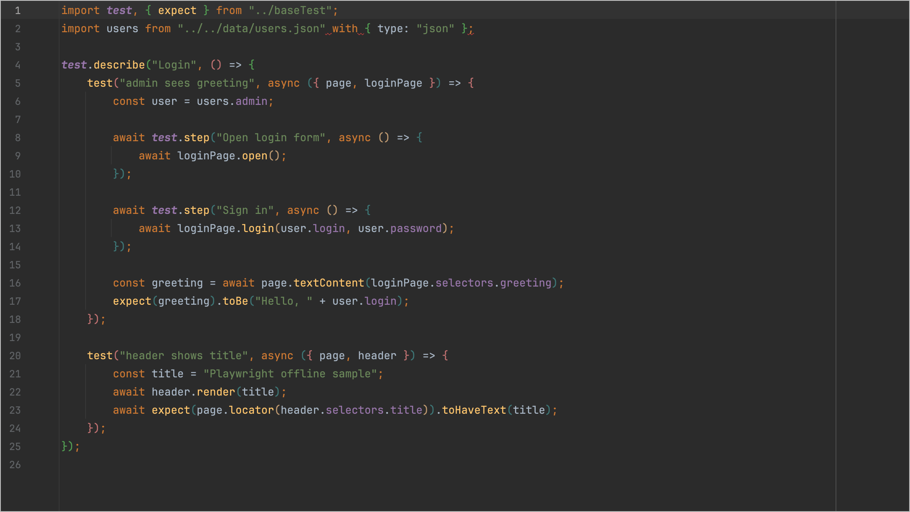
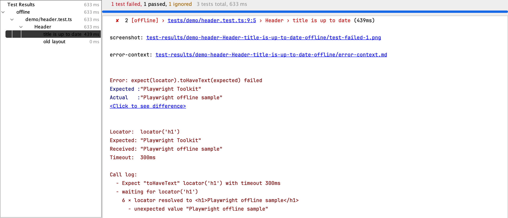
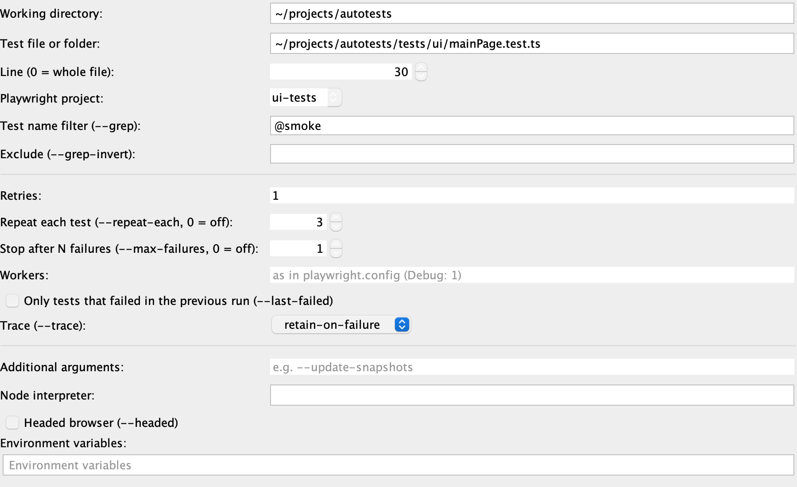
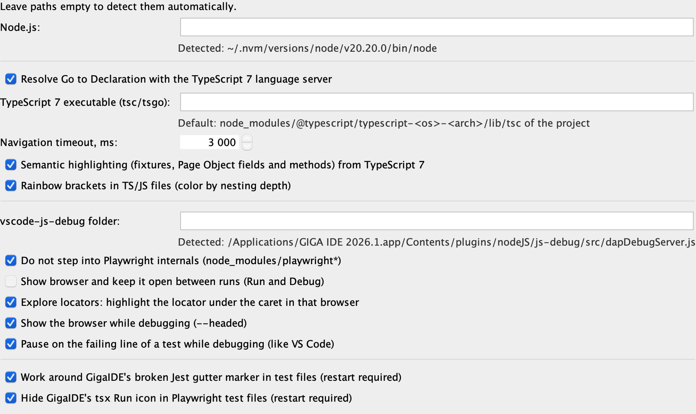

# Playwright Toolkit — руководство пользователя

Плагин для GigaIDE 2026.1 для работы с автотестами на Playwright + TypeScript: навигация и подсветка кода, запуск и отладка тестов, результаты прогона, отчёты и подсветка локаторов в браузере.

## Содержание

1. [Установка и проверка окружения](#1-установка-и-проверка-окружения)
2. [Навигация, подсветка и автодополнение](#2-навигация-подсветка-и-автодополнение)
3. [Запуск тестов](#3-запуск-тестов)
4. [Дерево тестов и результаты](#4-дерево-тестов-и-результаты)
5. [Параметры прогона](#5-параметры-прогона)
6. [Trace, скриншоты и отчёт](#6-trace-скриншоты-и-отчёт)
7. [Отладка](#7-отладка)
8. [Show Browser, Explore locators, Pick Locator](#8-show-browser-explore-locators-pick-locator)
9. [Меню Tools → Playwright](#9-меню-tools--playwright)
10. [Шаблоны кода](#10-шаблоны-кода)
11. [Настройки](#11-настройки)
12. [Если что-то не работает](#12-если-что-то-не-работает)

---

## 1. Установка и проверка окружения

1. Скачайте `playwright-toolkit-<версия>.zip` со страницы [Releases](https://github.com/tepmehatop/gigaide-playwright-toolkit/releases). Распаковывать не нужно.
2. GigaIDE: **Settings → Plugins → ⚙ → Install Plugin from Disk…** → выберите zip → перезапустите IDE.
3. В проекте с автотестами выполните `npm install`. Нужны `@playwright/test` и, для навигации и подсветки, `typescript` в `devDependencies`: `typescript@^7` (нативный сервер) или TypeScript 5/6 (сервер на Node.js — см. раздел 12).
4. **Tools → Playwright → Check Environment** покажет, что плагин нашёл:

```
Project: ~/projects/autotests
✓ Node.js: ~/.nvm/versions/node/v20.20.0/bin/node v20.20.0
✓ Playwright: Version 1.64.1
✓ Chrome for Testing 156.0.8078.4 (playwright chromium v1248)
✓ TypeScript server auto (navigation, highlighting): TypeScript 7 …/node_modules/@typescript/typescript-darwin-x64/lib/tsc
✓ vscode-js-debug (debugging): …/GIGA IDE 2026.1.app/Contents/plugins/nodeJS/js-debug/src/dapDebugServer.js
• playwright-extended-report: installed
```

Строка с ✗ подсказывает, что сделать: например, браузеры ставятся через **Tools → Playwright → Install Browsers**.

## 2. Навигация, подсветка и автодополнение

**Переход к объявлению** — Cmd+Click (Ctrl+Click) или Cmd+B на любом идентификаторе в `.ts`/`.js`:
- фикстура в `async ({ page, mainPage }) => …` → её объявление в `tests/baseTest.ts`;
- `mainPage.open()`, `header.selectors.logo` → метод или поле Page Object;
- свойства локальных объектов, импорты, значения в JSON;
- методы самого Playwright (`page.locator`, `page.fill`, `page.waitForResponse`, `locator.innerText`…) — в `types.d.ts` из `node_modules`.

**Автодополнение** (Ctrl+Space, после `.` открывается само): члены `page.`, `locator.`, фикстур и Page Object, ключевые слова (`await`, `const`), глобальные имена (`console`). Варианты даёт тот же TypeScript-сервер, что и переходы. У методов сразу добавляются скобки, курсор ставится внутрь.
Функции из других файлов проекта тоже предлагаются (справа видно, откуда, например `../../utils/customHelpers`): при выборе импорт добавляется в начало файла.

**Ошибки TypeScript** подчёркиваются в редакторе: неимпортированная функция, опечатка в имени метода, неверный тип аргумента. Причина — в подсказке при наведении; F2 — к следующей ошибке; список ошибок файла — в окне **Problems**. У ошибки появляется лампочка, **Alt+Enter** показывает исправления:
- от TypeScript: *Add import from …*, *Add missing function declaration …*, *Infer parameter types from usage* и другие;
- от плагина: `page` без типа → *Annotate 'page' as Page (@playwright/test)* (с импортом), `locator`/`selector`/`name` → *Annotate as string*, `name = string` → *Change '= string' to ': string'*.

**Параметры метода** — при вводе `(`, при клике внутрь скобок вызова, после запятой и по **Ctrl+P / Cmd+P**: `selectFromDropDown(page: Page, name: string, locator: string)`, текущий параметр выделен жирным.

**Подсказки имён параметров** — серые `locator:` / `name:` перед строками, числами, `true`/`false`/`null` в аргументах, как в IDEA.

**Использования**, как в IDEA:
- **Alt+F7** (Find Usages) — все использования метода, функции, фикстуры или поля по проекту в окне Find;
- **Cmd+Alt+F7 / Ctrl+Alt+F7** (Show Usages) — то же во всплывающем списке;
- **Ctrl+Click на объявлении** — список его использований;
- имя под курсором подсвечивается во всём файле;
- **Space / Ctrl+Shift+I** (Quick Definition) — код объявления во всплывающем окне;
- **Ctrl+Shift+P** (Type Info) — тип под курсором; **Cmd+Shift+B / Ctrl+Shift+B** — к объявлению типа (`page` → `Page`);
- над классами, функциями, методами и полями — «N usages», клик показывает использования;
- **Cmd+Alt+B / Ctrl+Alt+B** (Go to Implementation) — наследники и реализации; **Cmd+U / Ctrl+U** (Go to Super) — переопределённый метод, суперкласс; значки ↑/↓ в gutter у методов, классов и интерфейсов;
- **Ctrl+Alt+H** (Call Hierarchy) — кто вызывает функцию или метод и что вызывает она.

**Рефакторинги** — **Alt+Enter** на выделении или под курсором показывает рефакторинги TypeScript: *Extract to constant / function / method*, *Convert to async function*, *Add braces to arrow function*, *Convert to template string* и др. **Extract Variable / Constant / Field / Method** — Cmd+Alt+V / C / F / M (Ctrl+Alt+… на Windows/Linux); новое имя сразу переименовывается во всех вхождениях. С нативным TypeScript 7 рефакторинги выполняет TypeScript 5: плагин предложит установить его для IDE при первом Extract.

**Structure** — **Cmd+F12 / Ctrl+F12** (всплывающее окно) или окно **Structure**: классы, их поля и методы, функции, тесты файла.

**Документация** — при наведении мыши и по **Ctrl+Q / F1**: тип символа и его описание (JSDoc), в том числе для методов Playwright.

**Параметры без типа** — `function selectFromDropDown(page, locator) { await page.click(locator) }`: TypeScript не знает, что `page` — это Page. Тогда, как в IntelliJ, плагин ищет метод по имени в Playwright: Ctrl+Click на `click` предлагает `Page.click`, `Locator.click`…, после `page.` предлагаются методы Playwright. Для точной навигации и проверки типов укажите тип: `page: Page` (`import { Page } from "@playwright/test"`) — с `strict` в tsconfig TypeScript и так подчеркнёт параметр без типа.

**Подсветка** работает в тестах так же, как в WebStorm (на снимке — тема Darcula):



- `test`, `expect` — как глобальные функции и переменные;
- методы Page Object и Playwright — цвет методов;
- поля (`selectors`, `greeting`, `title`) — цвет полей;
- скобки `()` `{}` `[]` — **радужные** по уровню вложенности;
- параметры и фикстуры (`page`, `loginPage`) получают каждый свой цвет, если включить **Settings → Editor → Color Scheme → Language Defaults → Semantic highlighting**. Раздела JavaScript/TypeScript в Color Scheme нет — это нормально, настройка в Language Defaults действует и для них.

## 3. Запуск тестов

Слева от `test(` и `test.describe(` в gutter есть значок ▶. Клик по нему → **Run** или **Debug** этого теста или группы.

```
13  ▶  test("should display elements correctly", async ({ page, mainPage }) => {
       ┌──────────────────────────────────────┐
       │ ▶ Run 'should display eleme…'   ⌃⇧R │
       │ 🐞 Debug 'should display eleme…' ⌃⇧D │
       │   Modify Run Configuration…          │
       └──────────────────────────────────────┘
```

Другие способы:
- правый клик **внутри тела теста** в редакторе → Run / Debug — запускается именно этот тест;
- правый клик по **файлу или папке** в дереве проекта → Run / Debug — все тесты в нём;
- конфигурация «Playwright Test» в списке Run/Debug Configurations — её можно сохранить и переиспользовать.

После прогона значок у теста показывает результат последнего запуска: зелёный — прошёл, красный — упал.

## 4. Дерево тестов и результаты

После Run или Debug в окне Run (или во вкладке Debug) появляется дерево: проект → файл → `describe` → тест, со статусом и временем.



- **Двойной клик** по тесту открывает его строку в коде.
- У упавшего теста — текст ошибки, фрагмент кода и стек. Пути в стеке (`tests/demo/header.test.ts:9:5`) и вложения (`screenshot: …png`, `error-context: …md`) — **кликабельные ссылки**.
- Для `expect(...).toHaveText(...)` и других сравнений есть ссылка **Click to see difference** — сравнение ожидаемого и полученного в отдельном окне.
- Ретраи видны в выводе теста («Retry #1»), нестабильный тест помечается «Flaky».
- **Rerun Failed Tests** (кнопка на панели окна Run) перезапускает только упавшие тесты.
- Отчёты из `playwright.config.ts` (`html`, `playwright-extended-report`) при запуске из IDE **генерируются как обычно**: плагин добавляет свой репортер к ним, а не вместо них.

Если в проекте включена история `playwright-extended-report` (`insights: { history: {} }`), в выводе теста есть строка вида:

```
History (previous 5 runs, extended report): ✓✓✗✓✓ — failed 1 of 5, NEW failure
```

## 5. Параметры прогона

**Run → Edit Configurations… → Playwright Test** (или *Modify Run Configuration…* в меню значка ▶):



| Поле | Что делает |
|---|---|
| Working directory | Папка с `playwright.config.*` (заполняется автоматически) |
| Test file or folder, Line | Что запускать; строка `0` — весь файл |
| Playwright project | `--project`; выпадающий список берётся из вашего `playwright.config.ts` |
| Test name filter / Exclude | `--grep` / `--grep-invert`; автодополнение `@tag` по Ctrl+Space |
| Retries | `--retries`; пусто — как в конфиге |
| Repeat each test | `--repeat-each` — прогнать каждый тест N раз (ловить нестабильные) |
| Stop after N failures | `--max-failures` |
| Workers | `--workers`; при Debug по умолчанию 1 |
| Only tests that failed in the previous run | `--last-failed` |
| Trace | `--trace`: on / retain-on-failure / on-first-retry / off |
| Additional arguments | Любые другие флаги CLI |
| Headed browser | `--headed` |
| Environment variables | Переменные окружения прогона |

## 6. Trace, скриншоты и отчёт

Правый клик по тесту в дереве:

```
┌──────────────────────────────────────┐
│ Jump to Source                    F4 │
│ ▶ Run 'title is up to date'          │
│ …                                    │
│──────────────────────────────────────│
│ Open Trace                           │
│ Open Screenshot / Attachment...      │
│ Open in Report                       │
└──────────────────────────────────────┘
```

- **Open Trace** — Playwright Trace Viewer с трейсом этого теста. Trace появляется, если включён в конфиге проекта или в поле **Trace** конфигурации (например, `retain-on-failure`).
- **Open Screenshot / Attachment…** — скриншот открывается в IDE, видео — в системном плеере, `error-context.md` — в редакторе. Скриншоты появляются при `use: { screenshot: 'only-on-failure' }` в `playwright.config.ts`.
- **Open in Report** — если в проекте установлен `playwright-extended-report`, открывается **страница этого теста** (Insights, группы ошибок, AI-агент). Иначе — стандартный HTML-отчёт на главной странице.

**Открыть файл из отчёта прямо в GigaIDE.** В playwright-extended-report: ⚙ → «Открывать файлы в» → свой шаблон URL:

```
http://localhost:63342/api/file/{path}:{line}
```

Это встроенный сервер GigaIDE, консольный лаунчер не нужен.

## 7. Отладка

1. Поставьте брейкпоинт кликом по номеру строки — в тесте, фикстуре или Page Object.
2. Значок ▶ у теста → **Debug**.
3. Браузер открывается в видимом режиме, таймауты тестов отключены.

На паузе доступны:
- **Threads & Variables** — переменные кадра (фикстуры, `this` Page Object), стек вызовов;
- step over / into / out, Resume, Run to Cursor;
- Evaluate Expression (Alt+F8), watches, условные брейкпоинты;
- значения переменных прямо в строках кода серым, как в IDEA (Settings → Debugger → Data Views → Show values inline);
- подсказка значения при наведении на переменную;
- в DevTools браузера (F12) — объект `playwright` (`PWDEBUG=console`).

**Пауза на упавшем шаге.** Если `expect` или действие с локатором падает, отладчик останавливается **на этой строке**, пока тест ещё не завершился. В консоли Debug — текст ошибки, во всплывающем сообщении — «Test step failed…». Можно посмотреть переменные и страницу, потом нажать Resume. Отключается в настройках.

**Брейкпоинт не сработал?** В конце сессии в консоли Debug будет строка:

```
⚠ Breakpoint mainPage.test.ts:15 was never reached: … the test failed or was skipped earlier
```

Значит, тест упал раньше этой строки — ошибка выше в консоли.

## 8. Show Browser, Explore locators, Pick Locator

**Show Browser** — **Tools → Playwright → Show Browser (Keep Open Between Runs)**. Один видимый браузер не закрывается между прогонами (Run и Debug): видно, на какой странице остановился тест, а повторные запуски быстрее. Закрыть его — **Tools → Playwright → Close Browser**.

**Explore locators** работает, пока такой браузер открыт: ставите курсор на локатор в коде — элемент **подсвечивается в браузере**.

| Курсор на | Что подсвечивается |
|---|---|
| строке-селекторе в Page Object: `heroSection: "header.hero-section"` | этот селектор |
| `page.locator('…')`, `page.getByRole('link', { name: 'Find Bugs' }).first()` | этот локатор |
| `mainPage.selectors.heroSection` в тесте | значение селектора из Page Object (находит TypeScript-сервер) |
| любое выражение-локатор **на паузе отладчика** | вычисляется в текущем кадре: работают переменные, `this.selectors…` |

Действия (`click`, `fill`…) при этом **никогда не выполняются**: вычисляются только локаторы.

Порядок работы:
1. Включить Show Browser.
2. Запустить тест: страница останется открытой.
3. Ходить курсором по селекторам в Page Object или тесте и смотреть подсветку.

**Pick Locator in Browser** — правый клик в редакторе → *Pick Locator in Browser* (или Tools → Playwright). Откроется браузер выбора (при первом запуске — с адресом из `baseURL`), элемент под мышью подсвечивается, клик выбирает его. Профиль браузера сохраняется: войти на стенд нужно один раз.

Плагин предлагает только **уникальные на странице** локаторы, лучший первым:
`[data-qa=…]` → `[data-testid=…]` → `#id` → `input[name=…]` / `.class` → `getByRole(…, { name })` → `//tag[contains(text(), …)]` → внутри уникального родителя → по позиции (если ничего уникального нет). Выбранный вставляется у курсора: в кавычках — селектор, вне кавычек — код (`locator('[data-qa="login-field"]')`, `getByRole(...)`). Порядок атрибутов — в настройках (*Pick Locator: test attributes*).

**Проверка селекторов** — ошибки в строках `locator("…")`, `click("…")` и в объектах `selectors` подчёркиваются красным: незакрытые скобки XPath, `div >` без продолжения, `[=x]` и т. п.

## 9. Меню Tools → Playwright

```
Tools
└── Playwright
    ├── Show Browser (Keep Open Between Runs)   ☐/☑
    ├── Close Browser
    ├── ─────────────
    ├── Show Report
    ├── Record New Test (Codegen)...
    ├── Install Browsers
    ├── Check Environment
    └── Diagnose Highlighting
```

- **Show Report** — playwright-extended-report или стандартный HTML-отчёт проекта.
- **Record New Test (Codegen)** — открывает браузер и окно Playwright Inspector, которое записывает ваши действия как код теста.
- **Install Browsers** — `playwright install` для версии Playwright вашего проекта, вывод в окне Run.
- **Check Environment** — см. [раздел 1](#1-установка-и-проверка-окружения).
- **Diagnose Highlighting** — отчёт о подсветке строки под курсором (для обращения к разработчику плагина).

## 10. Шаблоны кода

В `.ts`/`.js`-файле наберите сокращение и нажмите **Tab**:

| Сокращение | Что вставляет |
|---|---|
| `pwt` | `test("…", async ({ page }) => { … });` |
| `pwd` | `test.describe("…", () => { … });` |
| `pwstep` | `await test.step("…", async () => { … });` |
| `pwbe` | `test.beforeEach(async ({ page }) => { … });` |
| `pwexp` | `await expect(page.locator(…)).toBeVisible();` — проверка выбирается из списка |
| `pwloc` | `page.locator("…")` |
| `pwfix` | фикстура для `test.extend`: `mainPage: async ({ page }, use) => { await use(new MainPage(page)) },` |
| `pwpage` | класс Page Object в стиле проекта: `path`, `selectors`, конструктор, `open()` |

| `log` | `console.log(…);` |
| `pwgoto`, `pwclick`, `pwfill` | `await page.goto("/")`, `await page.locator("…").click()`, `.fill("…")` |
| `pwrole`, `pwtid`, `pwtext`, `pwlabel` | `page.getByRole("button", { name: "…" })` и др. |
| `pwvis`, `pwhave`, `pwurl`, `pwtitle`, `pwsoft`, `pwpoll` | проверки `expect(...)` |
| `pwwait` | ожидание ответа API: промис до действия, `await` после |
| `pwroute`, `pwapi` | мок ответа через `page.route`, запрос через фикстуру `request` |
| `pwba`, `pwae`, `pwaa`, `pwonly`, `pwskip`, `pwfixme`, `pwdser`, `pwuse`, `pwslow`, `pwpause` | хуки и режимы тестов |
| `pwshot`, `pwattach`, `pwann` | скриншот, вложение и аннотация в отчёт |

**Шаблоны TypeScript/JavaScript** — как в WebStorm и сниппетах VS Code:

| Сокращение | Что вставляет |
|---|---|
| `fori`, `itar`, `ritar` | цикл с индексом; по массиву (`const element = array[i]`); в обратном порядке |
| `iter` / `forof`, `itin` / `forin`, `forawait`, `foreach` | `for…of`, `for…in`, `for await…of`, `array.forEach(...)` |
| `ifelse`, `switchc`, `whilel`, `dowhile`, `trycatch`, `tryf`, `thr` | условия, циклы, `try/catch[/finally]`, `throw new Error()` |
| `fn`, `afn`, `arrow`, `aarrow`, `constfn` | функции и стрелочные функции |
| `cls`, `ctor`, `met`, `getter`, `setter`, `prop`, `intf`, `typ`, `enm` | классы и типы (`prop`, `intf`, `typ`, `enm` — только в TypeScript) |
| `imp`, `impd`, `impa`, `expd`, `expc` | импорт и экспорт |
| `st`, `si`, `sleep` | `setTimeout`, `setInterval`, `await` задержки |
| `clg`, `logv`, `logj`, `logw`, `loge`, `logt`, `todo` | `console.*`, `JSON.stringify` значения, `// TODO:` |

Шаблоны не срабатывают внутри строк, комментариев и после точки.

**Постфиксные шаблоны**: допишите к выражению ключ и нажмите **Tab**:

| Ключ | Результат |
|---|---|
| `.log`, `.error` | `console.log(expr)` |
| `.const`, `.let` | `const locator = expr;` — имя предложено, его можно сразу перепечатать |
| `.await`, `.return`, `.not`, `.par` | `await expr`, `return expr;`, `!expr`, `(expr)` |
| `.if`, `.notnull`, `.null` | `if (expr) { }`, `if (expr != null) { }`, `if (expr == null) { }` |
| `.forof`, `.for`, `.fori` | `for (const row of rows) { }`, `for (const key in expr) { }`, `for (let i = 0; i < expr.length; i++) { }` |

**Новый тест** — в окне Project правый клик по папке → **New → Playwright Test**: файл с нужным суффиксом (`.test.ts`/`.spec.ts`, как в проекте) и импортом `test`, `expect` из `baseTest.ts` проекта.

Шаблоны можно поменять: **Settings → Editor → Live Templates → Playwright** и **TypeScript/JavaScript (Playwright Toolkit)**; постфиксные — **Settings → Editor → General → Postfix Completion**.

## 11. Настройки

**Settings → Tools → Playwright Toolkit**:



| Настройка | По умолчанию |
|---|---|
| Пути к Node.js, TypeScript (tsc/tsgo TS 7 или tsserver.js TS 5/6), vscode-js-debug | пусто — ищутся автоматически (найденный путь показан под полем) |
| TypeScript server: Auto / Native TypeScript 7 / tsserver.js / typescript-language-server | значение сборки (auto, tsserver или tsls) |
| Go to Declaration через TypeScript-сервер | вкл. |
| Code completion from TypeScript, TypeScript errors in the editor, Parameter name hints | вкл. |
| Semantic highlighting, Rainbow brackets | вкл. |
| Не заходить в код Playwright при step into | вкл. |
| Show browser and keep it open between runs | выкл. |
| Explore locators | вкл. (работает при Show Browser) |
| Show the browser while debugging | вкл. |
| Pause on the failing line while debugging | вкл. |
| Обходы ошибок GigaIDE (Jest-маркер, значок tsx) | вкл. |

## 12. Если что-то не работает

| Симптом | Причина и решение |
|---|---|
| Ctrl+Click по методу не работает | Курсор на метод → **Tools → Playwright → Diagnose Highlighting**, строка `goto '…'`: `server found nothing` — TypeScript не знает тип (например, переменная типа `any`); `SLOWER THAN TIMEOUT` — увеличьте Navigation timeout в настройках; `IDE CANNOT OPEN` — IDE не может открыть файл с объявлением |
| «Cannot find declaration to go», нет подсветки | Нет TypeScript в `node_modules` проекта: добавьте `typescript` в `devDependencies`. Проверка: Tools → Playwright → Check Environment |
| Diagnose Highlighting: `Exec failed, error=1 (Операция не позволена)` | Политика ОС запрещает запускать нативный TypeScript 7. Выберите в **Settings → Tools → Playwright Toolkit → TypeScript server** вариант *tsserver.js via Node.js* или *typescript-language-server* (или поставьте сборку `-tsserver`/`-tsls`). Нужен TypeScript 5/6 в `node_modules` проекта |
| У теста два значка ▶, второй даёт «tsx binary not found» | Второй значок — от плагина NodeJS GigaIDE (запуск через node:test). Плагин его скрывает в Playwright-тестах; перезапустите IDE после установки |
| В файле теста вечное «Analyzing…» | Ошибка плагина NodeJS GigaIDE (Jest-маркер). Обход включён по умолчанию; перезапустите IDE |
| Брейкпоинт не срабатывает | Тест упал раньше строки — см. сообщение «was never reached» в консоли Debug |
| Тест висит на `click()` | Элемента нет на странице: Playwright ждёт его до таймаута теста |
| Explore locators ничего не подсвечивает | Включите Show Browser и запустите тест, чтобы в браузере была открыта страница |
| Open in Report открывает главную страницу отчёта | Установлен только стандартный HTML-отчёт; страница теста открывается с playwright-extended-report |
| Нет Open Trace / скриншотов | Включите `trace` / `screenshot` в `playwright.config.ts` или поле Trace в конфигурации |
| Подсветка выглядит не так | Поставьте курсор на строку → Tools → Playwright → Diagnose Highlighting и пришлите отчёт |

Сообщения плагина пишутся в лог IDE с меткой `[pwtoolkit]` (Help → Show Log in Finder → `idea.log`).
